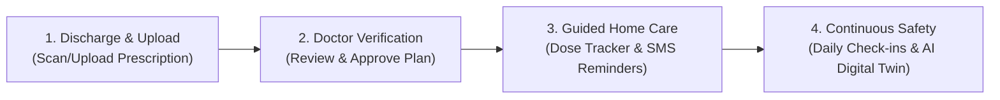

# 🏥 Recovera AI

> **Continuous, hospital-supervised post-discharge recovery management.**  
> Bridging the critical care gap between hospital discharge and full healing at home.

---

## 🌟 Why Recovera AI?

When patients leave the hospital after surgery or intensive treatment, they face a stressful transition:
- **Complex paper prescriptions:** Handwriting is difficult to interpret, dosages are confusing, and timing rules are easy to forget.
- **Unnoticed warning signs:** Early symptoms of infection or complications often go unmonitored until a patient ends up back in the emergency room.
- **Communication barriers:** Many patients and families prefer receiving reminders and instructions in their local language.

**Recovera AI solves this.** It transforms static paper discharge documents into an interactive, clinician-verified digital recovery plan that guides patients step-by-step through their healing journey while keeping doctors and nurses connected.

---

## 🔄 How It Works



### 1. 📄 Smart Prescription Digitization
The patient or care coordinator uploads a photo or PDF of the paper prescription or discharge summary. The system automatically reads the medications, dosages, frequency, and care instructions.

### 2. 👨‍⚕️ Clinician-in-the-Loop Approval
Safety comes first. AI extractions are never published blindly. Attending doctors or clinical staff review, adjust, and formally approve the extracted medications and schedule before it reaches the patient.

### 3. ⏰ Interactive Home Recovery Tracker
Patients receive an easy-to-use daily schedule showing exactly when to take each medicine with clear instructions (e.g. *after food*, *before sleep*). 
- **SMS Reminders:** Important medicine alerts are sent directly to the patient's phone.
- **Multilingual Read-Aloud:** Audio playback of instructions in **English, Tamil, and Hindi**.

### 4. 📈 Proactive Recovery Digital Twin
Patients log a quick daily check-in (pain level, temperature, mobility, wound condition). The clinical digital twin compares actual recovery data against expected clinical milestones. If symptoms diverge or red flags appear, the hospital care team is immediately alerted to intervene before complications escalate.

---

## ✨ Key Features

- **🔍 Intelligent Document Extraction:** Converts handwritten or printed clinical prescriptions into structured digital schedules.
- **🛡️ Safety-First Human Verification:** Every medication plan requires verified doctor/nurse authorization.
- **💊 Real-Time Medication Adherence:** Simple 1-tap dose logging with visual calendar history and adherence scores.
- **🗣️ Multilingual Support:** Tailored instructions and SMS notifications in English, Tamil, and Hindi.
- **🩺 Quick Clinical Consultations:** Built-in conflict-free doctor scheduling and 15-minute video teleconsultations.
- **📊 Hospital Clinical Command Center:** Triage dashboard prioritizing patients by recovery risk, adherence gaps, or acute symptoms.
- **🔐 Secure Role-Based Access:** Isolated views and strict permissions for Doctors, Nurses, Administrators, and Patients.

---

## 🚀 Getting Started

### ⚡ Quick Launch (Windows 1-Click)
1. Double-click **`run.bat`** in the project folder.
2. It automatically starts both the backend API and frontend portal.
3. Open your browser at: **[http://localhost:5173](http://localhost:5173)**

---

### 🐳 Run with Docker
You can also launch the full stack (PostgreSQL database, FastAPI backend, and frontend) with Docker Compose:
```bash
docker compose up -d
```
Visit **[http://localhost:80](http://localhost)** to use the platform.

---

### 💻 Manual Startup

#### Terminal 1: Backend API (FastAPI)
```bash
cd backend
python -m uvicorn app.main:app --reload --host 127.0.0.1 --port 8000
```
* **API Documentation:** [http://127.0.0.1:8000/docs](http://127.0.0.1:8000/docs)
* **Health Check:** [http://127.0.0.1:8000/api/health](http://127.0.0.1:8000/api/health)

#### Terminal 2: Web Portal (React / Vite)
```bash
cd frontend
npm run dev
```
* **Web App:** [http://localhost:5173](http://localhost:5173)

---

## 👥 User Roles & Portals

- **Doctor:** Reviews digitized prescriptions, manages treatment plans, conducts follow-up consultations, and inspects high-risk patient alerts.
- **Nurse / Care Coordinator:** Enrolls patients upon discharge, coordinates care, assists triage, and monitors daily check-in adherence.
- **Patient:** Views daily medication schedules, logs doses, submits symptom check-ins, and connects with their clinical team.
- **Hospital Administrator:** Manages staff accounts, security audit logs, system configurations, and facility-wide analytics.

---

## 🏗️ Technology Stack

- **Frontend:** React 18, Vite, Lucide Icons, Responsive CSS
- **Backend API:** FastAPI (Python 3.12), SQLAlchemy 2.0, Pydantic V2
- **Intelligence:** Multimodal OCR, Machine Learning handwriting pipeline, Google Gemini API
- **Databases:** PostgreSQL (Production / Neon) with automatic local SQLite fallback
- **Messaging & Notifications:** Unified Outbound SMS Bridge & Real-Time Staff WebSockets

---

## 📄 Clinical Decision Support Notice

*Recovera AI provides explainable statistical telemetry and digital recovery guidance for post-discharge care. It does not replace independent clinical judgment. All care plans, medication updates, and medical interventions require authorization from qualified healthcare practitioners.*
